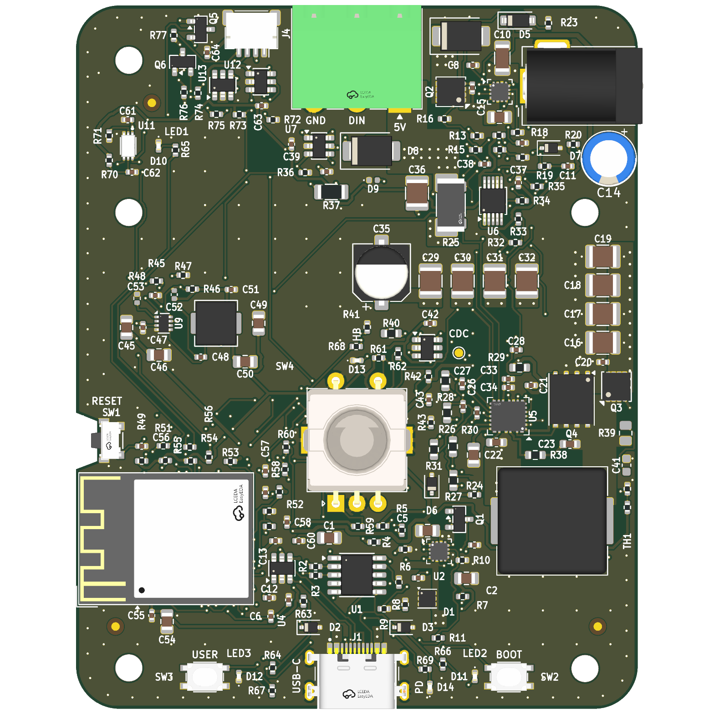
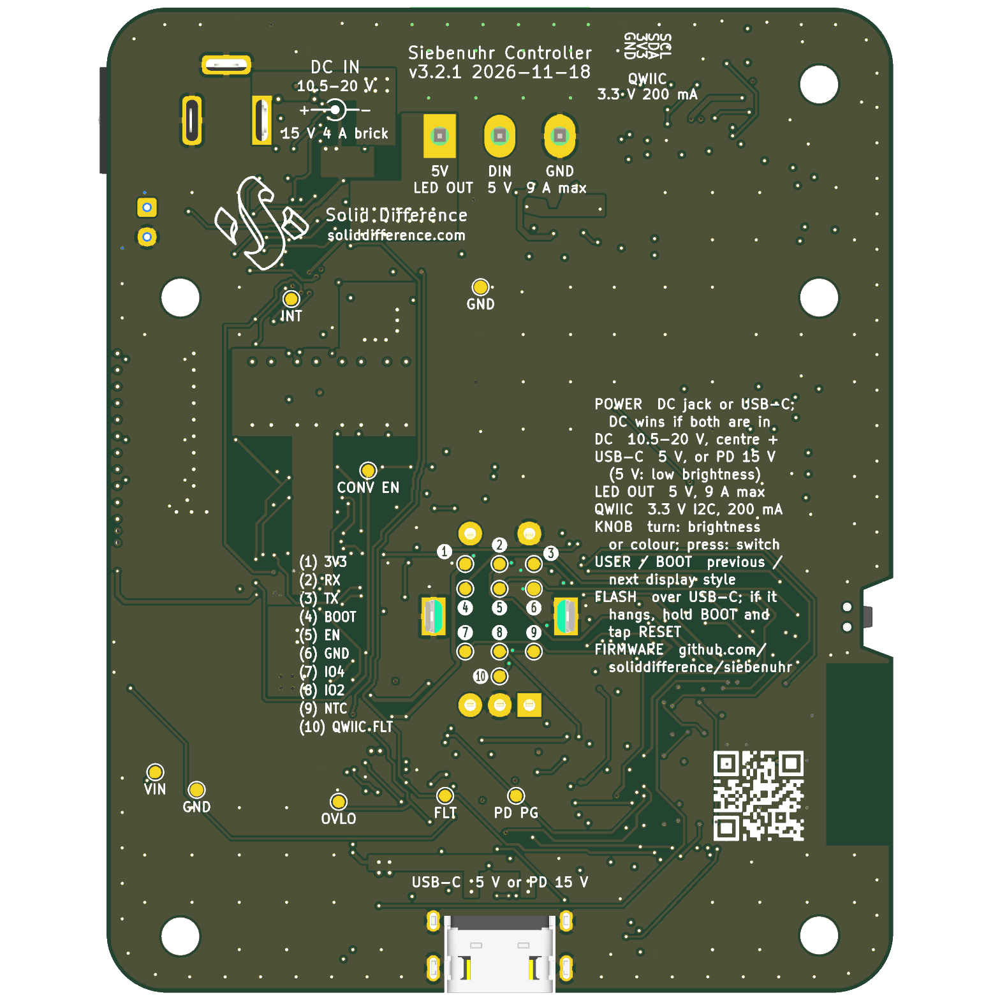

# Controller v3: hardware and what the firmware must do

Status (2026-11-21): the controller hardware is at **v3.2.1** (released 2026-11-18). A first run of 5 prototype boards
is being ordered. **Nothing here has been tested on a built board yet**, and the firmware does not support v3 yet:
`siebenuhr_core` still has v2's ESP32 pins and drives an INA219. This page collects what the firmware needs to know
to support v3 fully. The source is the hardware repository, `siebenuhr-controller-hw` at v3.2.1, mainly its
`docs/design/firmware-notes.md`, `mcu-ui.md`, `led-power.md`, `power-input.md`, and the failure reviews in
`docs/reviews/`.

| Top | Back |
|---|---|
|  |  |

## The board in short

- **66.5 × 83.25 mm, 4 layers.** It drives the regular clock: 476 WS2812B LEDs, 4 digits × 7 segments × 17 LEDs
  (`esp32-regular`).
- **MCU:** ESP32-S3-MINI-1-N8 (8 MB flash, no PSRAM). The USB-C port goes to the S3's native USB, and there is no
  USB-UART chip. UART0 is on test pads TP10 (TX, GPIO43) and TP11 (RX, GPIO44).
- **Power in:** two inputs, each behind its own eFuse (TPS259470A). DC has priority over USB when both are plugged in.
  - **USB-C PD:** a CH224A asks the charger for 15 V. Without PD (a laptop port or a simple charger) the board runs
    on 5 V with a smaller budget.
  - **DC barrel jack:** 5.5 × 2.1 mm, centre positive, 10.5–20 V. A 15 V / 4 A brick ships with each clock.
- **LED power:** a TPS55288 buck-boost makes the 5 V LED rail from either input. **It is off at power-up, and the
  firmware has to switch it on** over I²C, after setting a current limit. An INA226 measures the LED current and
  voltage on a 5 mΩ shunt.
- **LED budget:** 9 A in firmware and 9.5 A in the converter. Four digits at full brightness in the default colour
  average about 8.2 A; the brightest time, 08:08, would need 10.6 A and has to be dimmed.
- **UI:** the same EC11 encoder with push switch, USER and BOOT buttons, a side RESET button, five indicator LEDs, a
  BH1750 light sensor and a Qwiic port, as on v2 but on new pins.

### What changed since v2

| | v2.2 | v3 |
|---|---|---|
| MCU | ESP32-MINI-1 (4 MB) + CP2102N USB-UART | ESP32-S3-MINI-1-N8, native USB |
| USB power | CH224K fixed at 5 V (15 W at most) | CH224A asking for 15 V, readable over I²C |
| DC input | 2-pin 5 V header | 15 V barrel jack, eFuse, reverse-polarity FET |
| LED rail | straight off the 5 V input | TPS55288 at 0x74, off until firmware enables it |
| Current sensor | INA219 at 0x40 (10 mΩ, not Kelvin) | INA226 at 0x41 (5 mΩ Kelvin shunt) on the LED output |
| Light sensor | BH1750 at 0x23 | BH1750 at 0x23 (unchanged) |
| Qwiic | JST PH, on the main bus | JST SH, current-limited, switchable, cut from the main bus when off or shorted |
| New signals | | input voltage, input current per eFuse, converter temperature, PD status, faults |

## Pin map

From the v3.2.1 schematic's netlist. The `siebenuhr_core.h` names are today's constants.

| Function | Constant today | v2 GPIO | v3 GPIO | Notes |
|---|---|--:|--:|---|
| LED data (WS2812B) | `LED_GLYPH_PIN` | 21 | **39** | Through a 5 V level shifter. A 4.7 kΩ pull-down holds it low at reset. Use RMT. |
| Heartbeat LED (orange, "HB") | `LED_HEARTBEAT_PIN` | 5 | **38** | PWM, active high |
| LED1 (white, by the light sensor) | `LED1_PIN` | 22 | **42** | PWM, active high. No fixed job. |
| LED2 (white, BOOT button light) | `LED2_PIN` | 19 | **12** | PWM, active high |
| LED3 (white, USER button light) | `LED3_PIN` | 23 | **11** | PWM, active high |
| PD LED (yellow-green, "PD") | new | | **7** | Active high. Meant to show the USB PD state. |
| USER button | `USER_BUTTON_PIN` | 33 | **5** | Active low. 4.7 kΩ external pull-up, 1 kΩ + 10 nF filter. |
| BOOT button | `BOOT_BUTTON_PIN` | 0 | **0** | Active low. Boot strap (10 kΩ pull-up); firmware also reads it as a button. |
| Encoder A | `ROT_ENC_A_PIN` | 26 | **47** | Active low, 4.7 kΩ pull-up, 1 kΩ + 10 nF |
| Encoder B | `ROT_ENC_B_PIN` | 27 | **21** | Same |
| Encoder switch | `ROT_ENC_BUTTON_PIN` | 18 | **48** | Same |
| I²C SDA (main bus) | `SDA_PIN` | 14 | **41** | 4.7 kΩ pull-ups on the board |
| I²C SCL (main bus) | `SCL_PIN` | 13 | **40** | |
| PD I²C SDA | new | | **14** | CH224A only, through 1 kΩ. **Internal pull-ups off:** the CH224A's own (7–15 kΩ) are the bus pull-ups. |
| PD I²C SCL | new | | **13** | |
| `PD_PG` | new | | **15** | CH224A: PD contract present, active low |
| `EFUSE_FLT` | new | | **16** | eFuse fault: both eFuses' open-drain outputs wired together, active low, 10 kΩ pull-up. Input only. |
| `PWR_INT` | new | | **17** | TPS55288 INT (and INA226 ALERT, if set up), active low |
| `QWIIC_EN` | new | | **18** | Qwiic port power. Pulled up on the board, so the port is on at boot. |
| `QWIIC3_FLT` | new | | **6** | Qwiic switch fault, open drain, active low. Enable the internal pull-up. |
| `VIN_SENSE` | new | | **8** | ADC1. VIN / 11.0. |
| `USB_ILM` | new | | **9** | ADC1. USB input current, 0.110 V/A |
| `DC_ILM` | new | | **10** | ADC1. DC input current, 0.137 V/A |
| `NTC_SENSE` | new | | **1** | ADC1. Converter temperature (below) |
| USB D− / D+ | | | 19 / 20 | Native USB (USB-Serial/JTAG) |
| UART0 TX / RX | | | 43 / 44 | Test pads TP10 / TP11 |
| Spare | | | 2, 4 | On test pads TP17 / TP18. Pull them down. |

Leave alone: GPIO3, 45 and 46 (boot straps, unconnected), GPIO26–32 (the module's flash) and GPIO33–37 (octal PSRAM
on the module's PSRAM variants; left free so the board can take one).

## I²C

- **Main bus (GPIO41/40):** BH1750 at 0x23, INA226 at 0x41, TPS55288 at 0x74, and whatever is on the Qwiic port.
  400 kHz works on the board; 100 kHz is the safe default with Qwiic boards on a cable. A Qwiic device at 0x23, 0x41
  or 0x74 collides with the on-board parts.
- **PD bus (GPIO14/13):** the CH224A at 0x22/0x23, at **100 kHz**. It is powered from USB, so it only answers while
  USB power is present. The bus has no pull-ups of its own besides the CH224A's: keep the S3's internal pull-ups off
  (`sda/scl_pullup_en = false`), since any pull-up to 3.3 V would half-power an unpowered CH224A. That gives a
  presence test: with both pins as inputs without pulls, both read high only while the CH224A is alive. Keep them
  Hi-Z until both have read high for about 50 ms. `PD_PG` reads high (no contract) when USB power is absent.
  - Start the bus only when USB is present (`VIN_SENSE`, a successful probe, or `PD_PG` low), and expect NACKs on DC
    alone. Probe both 0x22 and 0x23 (the datasheet gives "0x22 or 0x23"). Single-byte reads and writes only.
  - Registers: 0x09 status (BC, QC2, QC3, PD or EPR active); 0x50 the PD contract's maximum current in 50 mA units
    (valid only with PD); 0x60–0x8F the source's capabilities (raw SRCCAP). 0x0A requests a voltage and is
    write-only, so the contract voltage can't be read back. Leave 0x0A alone (requirement 6).
- **Expect errors and retry.** The TPS55288's I²C pins are unpowered whenever its EN is low: at every power-up and
  power-down, under-voltage trip and source hand-over. Retry on NACK, and recover a stuck bus with 9 clocks.
- **Qwiic port:** a TPS2553 limits it at 234–303 mA. The board prints "200 mA", which keeps under that and under the
  Qwiic cable's 226 mA rating. Switching `QWIIC_EN` off really unpowers the port, and Q5/Q6 then cut it from the main
  bus, so a shorted Qwiic device can't hold the on-board bus low. After switching it back on, wait at least 3 ms plus
  the device's own start-up time.

## What the hardware guarantees, without firmware

- **The LED rail is off after power-up,** and after the converter has cut out (under-voltage, over-voltage). The
  TPS55288 resets its registers (OE = 0) only when its EN pin goes low.
- **An MCU-only reset (watchdog, panic, OTA, esptool, the RESET button) leaves the LEDs running** at the last setpoint
  and limit. The firmware has to switch the rail off itself (requirement 1).
- **LED output ceiling:** 10 A at power-up (register default, output still off). On a hard short the average
  inductor-current limit (10.4–14.1 A) holds and the converter hiccups.
- **LED rail over 5.6 V,** or **VIN under about 4.1 V:** a TPS3701 pulls the converter's EN low, which shuts it down
  and resets it to its defaults. The MCU keeps running down to about 3.8 V.
- **Input limits:** USB about 5.5 A, DC about 4.45 A (3.96–4.94 A). Each input cuts off above about 22 V, soft-starts
  and blocks reverse current. DC switches on only above about 10 V (off below about 9.2 V), so 5 V and 9 V adapters
  leave it off. A reversed DC plug is blocked.
- **DC unplugged while USB is attached:** VIN drops to about 9.2 V before the USB eFuse takes over. Above about
  10–20 W of LED load the TPS3701 cuts the converter (resetting its registers), and the MCU may brown out. Below that
  the hand-over is seamless. Requirements 10 and 12 handle the recovery.
- **eFuse variant:** this page assumes the TPS259470A that v3.2.1 fits. Check U2/U3's top marking at bring-up: 2A9H
  is TPS259470A. 2ACH would be TPS259474L, which trips at 5.5 A, latches off and makes GPIO16 a control, with other
  rules (the hardware repository's `power-input.md` §2.3.9).

## Firmware requirements

These are `firmware-notes.md`'s rules and the open firmware duties from failure review round 4, with the TPS259470A
eFuses that are fitted. The numbers here are this page's; the hardware repository's rule numbers are in brackets.

### At boot, before anything else

1. **Switch the LED rail off first:** write TPS55288 06h = 0x30 (OE = 0) and drive GPIO39 low. Do the same in the
   panic handler and before any planned restart or OTA. [rule 11]
2. **Brown-out detector at level 3 or 4,** not ESP-IDF's default level 7 (2.44 V): a source hand-over can dip +3V3 to
   2.44–3.0 V, below the flash's 2.7 V minimum. No flash writes within 1 s of boot or while VIN sags, and rate-limit
   NVS writes. [review round 4, duty 5]
3. **Watchdogs:** the task and interrupt watchdogs on, with the panic handler setting OE = 0. [duty 8]
4. **Pins:** `EFUSE_FLT` (GPIO16) as an input; it has its own 10 kΩ pull-up. `QWIIC3_FLT` (GPIO6) with its internal
   pull-up. GPIO2 and GPIO4 pulled down. The RTC clock on the internal RC, so nothing claims GPIO15/16. [duty 9]

### Know the source, then light the LEDs

5. **Set a current limit and VOUT before OE.** Never set OE with the reset-default 10 A limit unless the source is known
   to support it. [rule 1]
6. **Budget per source:** [rule 2]
   - **Which input is live:** there is no DC-sense signal. Infer DC from `DC_ILM` > 0 or `USB_ILM` ≈ 0.
     [power-input.md §7]
   - **USB PD:** read the contract current (CH224A 0x50). The contract voltage can't be read: it is the 15 V the
     CH224A requested, so confirm it with `VIN_SENSE`. Budget = V × I × 0.85, turned into an LED-rail current limit.
     **Keep OE = 0 while a contract or voltage change is in progress.** [power-input.md §7]
     **Never request a different voltage:** the CH224A asks for 15 V by its resistor, so leave its 0x0A register
     alone. 20 V puts the USB eFuse too close to its over-voltage cut-off, and 28 V or EPR would destroy the input's
     TVS.
   - **USB without PD:** the charger's current advertisement can't be read. Start at 0.5 A input-equivalent and step
     up while `VIN_SENSE` stays at 4.75 V or more, up to 3 A.
   - **DC:** ramp on every source. Start at about 1 A of input and step up while VIN holds within about 5 % of its
     starting value. A smaller brick with the same plug would otherwise hiccup at full load. With the supplied
     brick the ramp takes about a second.
   - **Input current caps:** keep `USB_ILM` under min(contract current, 4.5 A), 0.50 V at the pin. Keep **`DC_ILM` ≤
     0.52 V**, which is 3.8 A at the typical gain. Set the DC cap as a voltage and don't calibrate it: the eFuse's
     trip sits at a fixed ILM voltage (about 0.61 V), so 0.52 V stays at 85 % of the trip on every part. Calibrate
     `DC_ILM` for display only. Stop the ramp on `DC_ILM`, not only on VIN sag.
   - **DC output ceiling:** on DC, **IOUT_LIMIT ≤ min(9.5 A, 0.69 A/V × VIN − 1.1 A)**, with VIN from `VIN_SENSE`:
     5.9 A at 10.1 V, 7.2 A at 12 V, 9.25 A at 15 V. Set it before OE and again with every sag-watch change. It comes
     before requirement 13's 9.5 A. The `DC_ILM` cap is filtered (4.7 ms) and can't catch a bright frame before the
     eFuse limits; this ceiling holds in the converter. [rule 2, review round 4 V4]
7. **Brightness at boot:** ramp up to the saved brightness over 1–2 s, only after requirements 5 and 6. Never restore
   full brightness in one step: that was v2's failure. [rule 7]

### The converter (TPS55288 at 0x74)

8. **Enable sequence:** [led-power.md §7]
   1. Read 07h (STATUS; reading clears it).
   2. Write 04h = 0x00: internal feedback.
   3. Write REF: 00h = 0xC0, then 01h = 0x03 for 5.00 V. Writing 01h loads the DAC.
   4. Write 02h = 0x80 | round(I_A × 10): the current limit in 0.1 A steps (e.g. 0xD0 = 8.0 A). Never above 0xE4
      (10.0 A), though the register allows 12.7 A. Where the value is a ceiling (requirement 6), round down:
      9.25 A is 0xDC, not 0xDD.
   5. Write 05h = 0xA0 (OCP indication masked while turning on).
   6. Write 06h = 0xB0: OE = 1, HICCUP = 1, DISCHG = 1. Soft start takes 4 ms.
   7. Write 05h = 0xE0 to re-enable OCP indication on `PWR_INT`.
   - **Off:** 06h = 0x30. DISCHG pulls the rail below 0.8 V in about 30 ms.
   - **Never write 04h ≠ 0x00.** Any INTFB other than 00 (for example its reset value, 11) with REF near 0x3C0 puts
     about 20 V on the LED rail. Register 04h's external-feedback setting is forbidden too. Never set the
     external-VCC bit in 06h together with OE. [rule 17]
   - **Setpoint at most 5.10 V,** trimmed with REF until the INA226 reads 5.10 V or less, though the DAC reaches
     5.32 V. The WS2812B's absolute maximum is 5.3 V, and a large brightness drop overshoots the rail by up to
     0.27 V. [rule 10]
   - **Limit how far the LED current falls in one frame,** about 3 A per frame, for the same reason. [rule 10]
   - Below about 3 A of budget the converter's limit is too coarse (±2 mV on 5 mΩ): close the loop on the INA226
     reading, with the converter's limit at about budget + 30 %. [led-power.md §7]
9. **Sag watch, all the time:** if `VIN_SENSE` drops more than about 10 % below the expected input (contract voltage,
   or the level seen at start, minus cable drop), cut the LED current limit at once with one IOUT_LIMIT write, then
   recover slowly, e.g. +5 % per second. [rule 3]
10. **After a hardware cut-off:** OE found 0 while the LEDs should be on, the rail missing on the INA226, or `PWR_INT`
    low.
    - On `PWR_INT`, first read TPS55288 06h (OE) and 07h (status), and INA226 06h (each status read clears it). If OE
      is still 1 and only over-current is flagged, it is not a cut-off: plugging the LED strip onto a live rail
      does that. Don't halve the budget for it. [duty 7, review round 4 V10]
    - For a real cut-off, wait until VIN is stable above 4.6 V for about 1 s, then re-enable with half the previous
      budget, and log the event. Expect it when DC is unplugged under load with USB attached. [rules 4, 15]
    - The converter's register reset after an under-voltage doesn't flag `PWR_INT`. Poll TPS55288 06h (OE) every
      100–200 ms, or set the INA226's bus-undervoltage alert (about 4.5 V) onto `PWR_INT` (register table below).
      [rule 12]
11. **No strip connected** (INA226 under 0.1 A with OE on): turn OE off and probe again. **Soft short** (rail under
    about 4.3 V at the current limit for 100 ms): OE = 0. If the rail stays above 1 V 100 ms after OE = 0 with
    DISCHG set, something else feeds the strip: clear DISCHG. [rule 12, duty 7]
12. **Brown-out safe mode:** count brown-out resets (the reset reason) in RTC memory or NVS. After 2–3 within a few
    minutes, boot with a hard brightness cap (e.g. 20 %) until the user changes it. [rule 5]
13. **LED budget:** start at 6 A, and allow the full 9 A (converter limit 9.5 A) only while `NTC_SENSE` reads below
    about 60 °C, until the first board's thermal check confirms it. No 10 A peaks. [rule 8]

### INA226 at 0x41

| Register | Value | Meaning |
|---|---|---|
| 00h | 0x4727 | 64× averaging, 1.1 ms + 1.1 ms, continuous: about 141 ms per result (0x4927 for 128×) |
| 05h | 0x0800 | I = reg × 0.5 mA (signed), P = reg × 12.5 mW, V_bus = reg × 1.25 mV |
| 06h / 07h | 06h = 0x8001, 07h = I_alert × 2000 (9 A → 0x4650) | Over-current alert onto `PWR_INT`, latched |
| 06h / 07h | 06h = 0x2001, 07h = 0x1180 | Alternative: bus over-voltage at 5.6 V. Only one alert function at a time. |
| 06h / 07h | 06h = 0x1001, 07h = 0x0E10 | Alternative: bus under-voltage at 4.5 V, latched, for requirement 10. These values are worked out from the INA226 register map (1.25 mV per bit), not taken from the hardware notes. |

### Sensors and inputs

14. **ADC attenuation:** `VIN_SENSE` at 0 dB below 9.35 V of VIN, 6 dB below 17.6 V, 12 dB above. The ILM channels at
    0 dB, `NTC_SENSE` at 12 dB. Use the chip's ADC calibration. [rule 13]
15. **Temperature from `NTC_SENSE`:** Murata NCP15XH103F03RC (10 kΩ, B 3434) with 4.7 kΩ:
    R(T) = 10 kΩ · exp(3434 · (1/T − 1/298.15)), V = 3.3 · R / (R + 4.7 kΩ). Derate from about 70 °C at the NTC,
    linearly down to 30 % of the budget at 90 °C; above 95 °C turn the LEDs off. The NTC reads 20–30 K below the
    converter's MOSFET junction. [rule 6]
16. **`EFUSE_FLT`:** debounce it, and ignore it for about 100 ms after power-up or a source change.
17. **Encoder:** decode it with a state table; the board filters each contact (1 kΩ + 10 nF). [duty 9]
18. **eFuses (ESP32 security):** don't burn flash-encryption or secure-boot eFuses unless +3V3 measures 3.30 V or
    less. [rule 17]
19. **LED1 off while the BH1750 measures.** LED1 sits 3.6 mm from the light sensor, as on v2, and whether its light
    reaches the sensor depends on the case. [review round 3, T1]

## UI as printed on the board

The back of the board carries usage notes, and the firmware should keep to them (or the silkscreen changes with the
next board revision):

- **KNOB:** turn for brightness or colour, press to switch between them.
- **USER / BOOT:** previous / next display style.
- **FLASH:** over USB-C; if it hangs, hold BOOT and tap RESET.
- **FIRMWARE:** github.com/soliddifference/siebenuhr

That is what `siebenuhr_core` does today for the regular clock. The top labels name the LEDs LED1–LED3, HB
(heartbeat) and PD.

## Flashing and building

- **Flashing:** esptool resets the S3 into download mode over its native USB, so no buttons are needed and the board
  can be reflashed while powered. If it hangs, hold BOOT and tap RESET.
- **Serial console:** over the native USB (USB-Serial/JTAG), or UART0 on TP10/TP11.
- **PlatformIO (suggested, untested):** a new environment for v3 with an ESP32-S3 board definition with 8 MB flash
  and no PSRAM (e.g. `esp32-s3-devkitc-1`), USB CDC on boot (`ARDUINO_USB_CDC_ON_BOOT=1`), and the v3 pin map. v2
  boards keep `esp32-regular`.

## What the firmware needs, in short

- [ ] A v3 pin map in `siebenuhr_core` (a second set of constants, or one chosen by a build flag), and a v3 build
      environment.
- [ ] Requirements 1–4 at boot.
- [ ] TPS55288 driver: the enable sequence, limits and setpoint (requirement 8).
- [ ] INA226 at 0x41 in place of the INA219 at 0x40 (`POWER_MONITORING_ENABLED`).
- [ ] Source detection and budget: CH224A over the PD bus, the ADC channels, the ramps and caps (requirements 5–7, 9).
- [ ] Recovery: cut-offs, no strip, brown-out safe mode (requirements 10–12).
- [ ] Thermal derating from the NTC (requirements 13, 15).
- [ ] Qwiic port control and fault handling.
- [ ] The PD LED.
- [ ] LED1 off while the light sensor measures (requirement 19).

The hardware repository's bring-up bench list (failure review round 4) tests these on the first boards.
